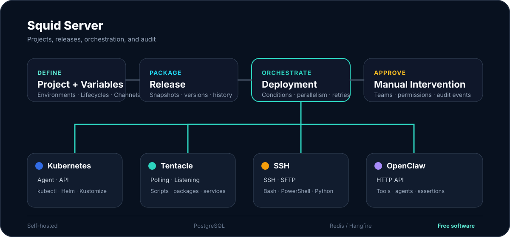

<div align="center">

<picture>
  <source media="(prefers-color-scheme: dark)" srcset="branding/squid-wordmark-reverse.png">
  
</picture>

### The free, simple, ready-to-use release platform

Enterprise-grade delivery for Kubernetes, servers, and AI agents — one pipeline from release to production.

<br>

[](https://github.com/SolarifyDev/Squid/actions/workflows/tests.yml)
[](LICENSE)

**English** · [简体中文](README.md)

<br>



</div>

<br>

## Features

<table>
<tr>
<td width="50%" valign="top">

**Free and self-hosted**<br>
No limits on projects, users, or deployment targets. No license fees.

</td>
<td width="50%" valign="top">

**Ready to use**<br>
One service and one database to run. Agents install with a single command.

</td>
</tr>
<tr>
<td valign="top">

**One release model**<br>
Projects, environments, lifecycles, channels, and releases — the same concepts across every target.

</td>
<td valign="top">

**Cloud native**<br>
Kubernetes Agent and API modes, with built-in Helm, Kustomize, and YAML.

</td>
</tr>
<tr>
<td valign="top">

**Enterprise governance**<br>
RBAC, API keys, manual approvals, and audit events. Sensitive variables are encrypted and masked in logs.

</td>
<td valign="top">

**Extensible**<br>
New targets and actions plug in as independent modules, without touching the pipeline.

</td>
</tr>
</table>

## Free, for good

Commercial release platforms typically charge by project, user, or target tier. Squid is MIT-licensed with every feature included, so growing your footprint never adds software cost.

| | Squid | Commercial platforms |
|---|:---:|:---:|
| Software cost | Free | Tiered subscription |
| Projects / users / targets | Unlimited | Limited by tier |

## Deployment targets

| Target | Connection |
|---|---|
| Kubernetes Agent | In-cluster agent connects outbound |
| Kubernetes API | Server connects to the cluster directly |
| Tentacle (Linux / Windows) | Polling or listening |
| SSH | No agent required |
| AI Agent | Agent tools invoked over HTTP API |

## Quick start

Run Squid Server (requires PostgreSQL and Redis):

```bash
docker build -f Dockerfile.Api -t squid-api .
docker run --rm -p 8080:8080 -p 10943:10943 squid-api
```

Install a Tentacle:

```bash
# Linux
curl -fsSL https://raw.githubusercontent.com/SolarifyDev/Squid/main/deploy/scripts/install-tentacle.sh | bash
```

```powershell
# Windows
irm https://raw.githubusercontent.com/SolarifyDev/Squid/main/deploy/scripts/install-tentacle.ps1 | iex
```

Deploy the Kubernetes Agent:

```bash
helm upgrade --install squid-agent deploy/helm/kubernetes-agent
```

> In production, inject database, certificate, and encryption-key settings through environment variables or a secret manager.

## Migrating from Octopus

Upload an Octopus export, preview and validate it, then import projects, environments, variables, and deployment processes in one step. Sensitive values are never restored from the export and must be re-entered in Squid.

## Documentation

- [Deployment pipeline architecture](docs/deployment-pipeline-architecture.md)
- [Kubernetes deployment architecture](docs/k8s-deployment-architecture.md)
- [Windows Tentacle installation](docs/windows-tentacle-install.md)
- [API keys and permissions](docs/api-key-permissions.md)

## License

[MIT](LICENSE)
