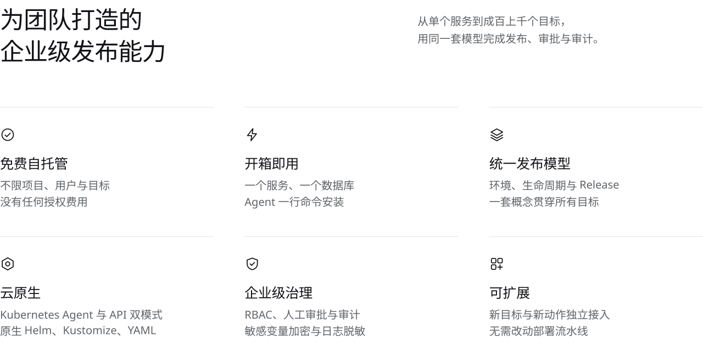
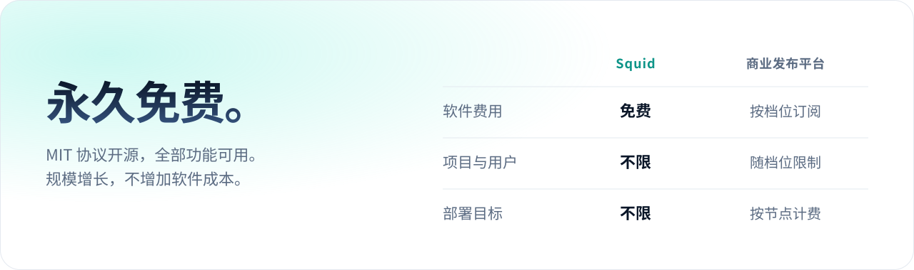

<div align="center">

<picture>
  <source media="(prefers-color-scheme: dark)" srcset="branding/squid-wordmark-reverse.png">
  
</picture>

<br><br>

<picture>
  <source media="(prefers-color-scheme: dark)" srcset="branding/readme/hero-zh-dark.svg">
  
</picture>

<br><br>

<a href="#快速开始"><b>快速开始</b></a>
&nbsp;&nbsp;·&nbsp;&nbsp;
<a href="#文档"><b>文档</b></a>
&nbsp;&nbsp;·&nbsp;&nbsp;
<a href="#从-octopus-迁移"><b>从 Octopus 迁移</b></a>
&nbsp;&nbsp;·&nbsp;&nbsp;
<a href="README.en.md"><b>English</b></a>

<br><br>

[](https://github.com/SolarifyDev/Squid/actions/workflows/tests.yml)
[](LICENSE)

</div>

<br>

<picture>
  <source media="(prefers-color-scheme: dark)" srcset="branding/readme/features-zh-dark.svg">
  
</picture>

<br><br>

<picture>
  <source media="(prefers-color-scheme: dark)" srcset="branding/readme/free-zh-dark.svg">
  
</picture>

<br>

## 快速开始

**运行 Server**（需 PostgreSQL 与 Redis）

```bash
docker build -f Dockerfile.Api -t squid-api .
docker run --rm -p 8080:8080 -p 10943:10943 squid-api
```

**连接部署目标**

```bash
# Linux Tentacle
curl -fsSL https://raw.githubusercontent.com/SolarifyDev/Squid/main/deploy/scripts/install-tentacle.sh | bash

# Kubernetes Agent
helm upgrade --install squid-agent deploy/helm/kubernetes-agent
```

```powershell
# Windows Tentacle
irm https://raw.githubusercontent.com/SolarifyDev/Squid/main/deploy/scripts/install-tentacle.ps1 | iex
```

> 生产环境请通过环境变量或密钥管理系统注入数据库、证书与加密密钥。

## 从 Octopus 迁移

上传 Octopus 导出文件，预览、校验后一键导入项目、环境、变量与部署流程。敏感值不会从导出文件恢复，需在 Squid 中重新填写。

## 文档

[部署流水线](docs/deployment-pipeline-architecture.md) · [Kubernetes](docs/k8s-deployment-architecture.md) · [Windows Tentacle](docs/windows-tentacle-install.md) · [权限模型](docs/api-key-permissions.md)

<br>

<div align="center"><sub>以 <a href="LICENSE">MIT 协议</a> 开源</sub></div>
