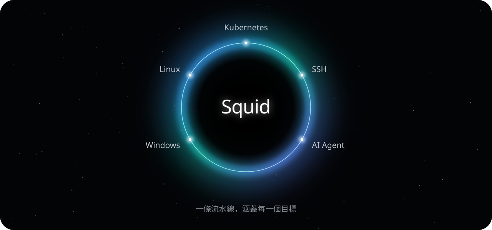
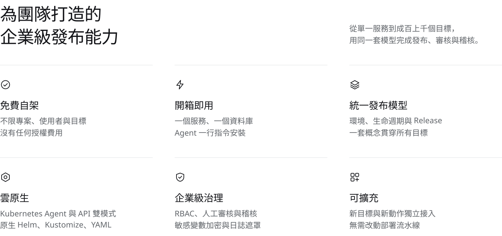
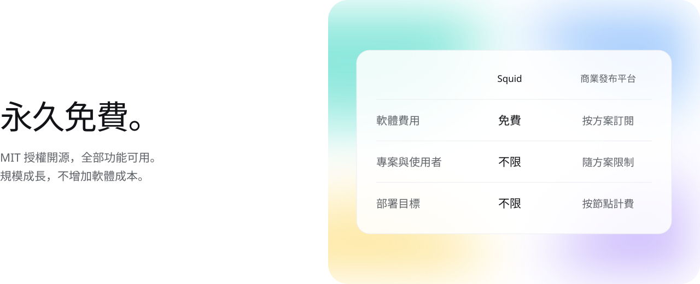

<div align="center">


### 免費、簡單、開箱即用的新一代發布平台

企業級發布能力，涵蓋 Kubernetes、Linux、Windows、SSH 與 AI Agent。<br>一條流水線，從 Release 到正式環境 —— 不限專案，不限使用者，不限目標。

<br>

[](https://github.com/SolarifyDev/Squid/actions/workflows/tests.yml)
[](https://github.com/SolarifyDev/Squid/releases)
[](#-快速開始)
[](#-快速開始)
[](https://dotnet.microsoft.com)
[](#-授權條款)

[English](README.md) · **繁體中文**

<br>

[](#-快速開始)
&nbsp;
[](https://github.com/SolarifyDev/Squid/releases)

<br>

<picture>
  <source media="(prefers-color-scheme: dark)" srcset="branding/readme/orbit-zh-tw-dark.svg">
  
</picture>

</div>

---

<picture>
  <source media="(prefers-color-scheme: dark)" srcset="branding/readme/features-zh-tw-dark.svg">
  
</picture>

<br><br>

<picture>
  <source media="(prefers-color-scheme: dark)" srcset="branding/readme/free-zh-tw-dark.svg">
  
</picture>

<br>

## 🚀 快速開始

**執行 Server**（需要 PostgreSQL 與 Redis）

```bash
docker build -f Dockerfile.Api -t squid-api .
docker run --rm -p 8080:8080 -p 10943:10943 squid-api
```

**連接部署目標**

```bash
# Linux Tentacle
curl -fsSL https://raw.githubusercontent.com/SolarifyDev/Squid/main/deploy/scripts/install-tentacle.sh | bash

# Kubernetes Agent
helm upgrade --install squid-agent deploy/helm/kubernetes-agent
```

```powershell
# Windows Tentacle
irm https://raw.githubusercontent.com/SolarifyDev/Squid/main/deploy/scripts/install-tentacle.ps1 | iex
```

> 正式環境請透過環境變數或金鑰管理系統注入資料庫、憑證與加密金鑰。

## 🔄 從 Octopus 遷移

上傳 Octopus 匯出檔，預覽、驗證後一鍵匯入專案、環境、變數與部署流程。敏感值不會從匯出檔還原，需在 Squid 中重新填寫。

## 📄 授權條款

[MIT](LICENSE) © Squid contributors.
